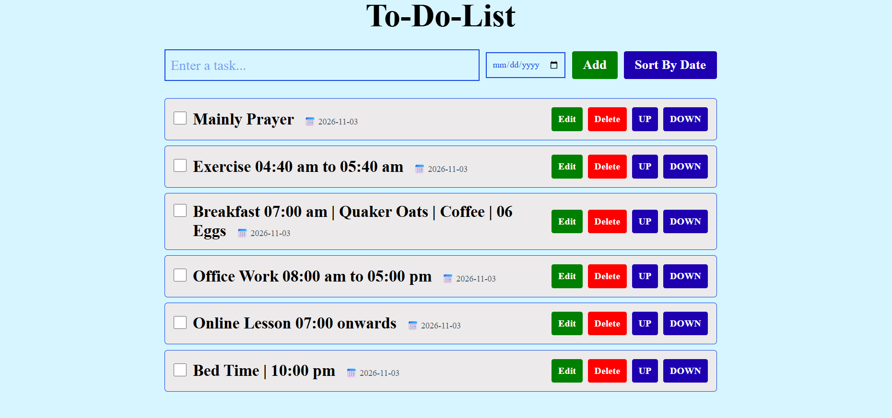
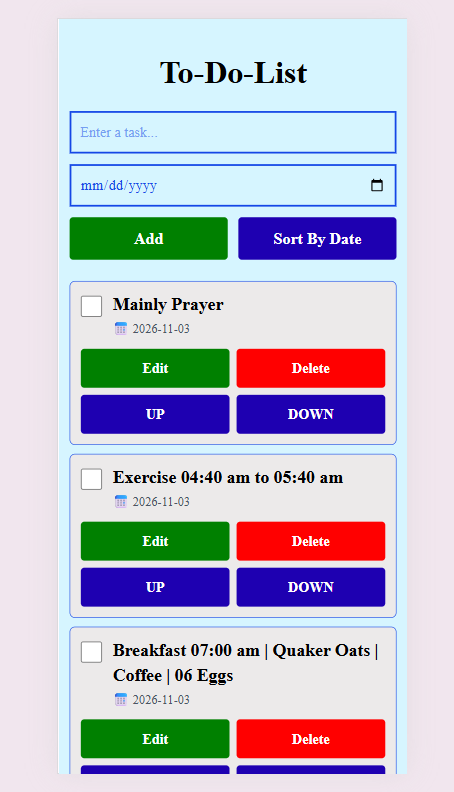

# To-Do List

A simple, responsive to-do list that helps you plan your day, set due dates, and see what is done, with no sign-up and no server.

**Live demo:** [add your live link here after deploying]

| Desktop | Phone |
| --- | --- |
|  |  |

## Why it is useful

- **Plan by deadline.** Give each task a due date, then sort the list by date so the most urgent work comes first.
- **Stay organized.** Edit a task, mark it done, delete it, or move it up or down to set your own priority.
- **Private by design.** Your tasks are saved in your own browser. Nothing is sent to a server, and no account is needed.
- **Works on any screen.** The layout adapts to phones, tablets, laptops, and large monitors.
- **Never lose your place.** Tasks save automatically, so they are still there when you come back.

## Features

- Add tasks with an optional due date (press Enter to add quickly)
- Edit a task's text and date, and save with Enter
- Mark tasks as completed (strike-through and a trophy)
- Delete tasks
- Move tasks up or down
- Sort tasks by due date (tasks without a date go to the bottom)
- Automatic saving in the browser, with older text-only tasks converted to the new format
- Responsive design with large, easy-to-tap buttons on phones

## Built with

- React (hooks: `useState`, `useEffect`)
- Tailwind CSS
- JavaScript (ES6)
- Browser `localStorage` for saving data
- [Vite] (check `package.json` and keep or remove this line)

## Getting started

You need [Node.js](https://nodejs.org) (LTS version) installed.

```bash
git clone https://github.com/MonDev883/todo-list-react.git
cd todo-list-react
npm install
npm run dev
```

Then open the address shown in the terminal (usually http://localhost:5173).

## How it works

- The list lives in React state and is saved to the browser's `localStorage` under the key `myTasks` every time it changes.
- When the app starts, it loads the saved list and converts any older text-only tasks into task objects with `text`, `completed`, and `date` fields.
- Editing swaps a task's row into an edit form, using conditional rendering, and saving puts the updated task back in the list.
- Sorting compares due dates, and tasks without a date stay at the bottom.

## Good to know

- Tasks are stored per browser and per device, so they do not sync between your phone and your computer.
- Clearing the browser's site data also clears the list.

## Ideas for next steps

- Give every task a unique id instead of using its position in the list
- Highlight overdue tasks
- Filters for all, active, and completed tasks
- Dark mode
- Export and import the list
- Categories or tags

## What I learned

- Managing state and side effects with React hooks
- Conditional rendering for an inline edit mode
- Saving data with `localStorage` and migrating older data safely
- Building a mobile-first responsive layout with Tailwind CSS
- Publishing a project on GitHub with a clear README

## Author

Raymond Cardel Mancera  
GitHub: [@MonDev883](https://github.com/MonDev883)